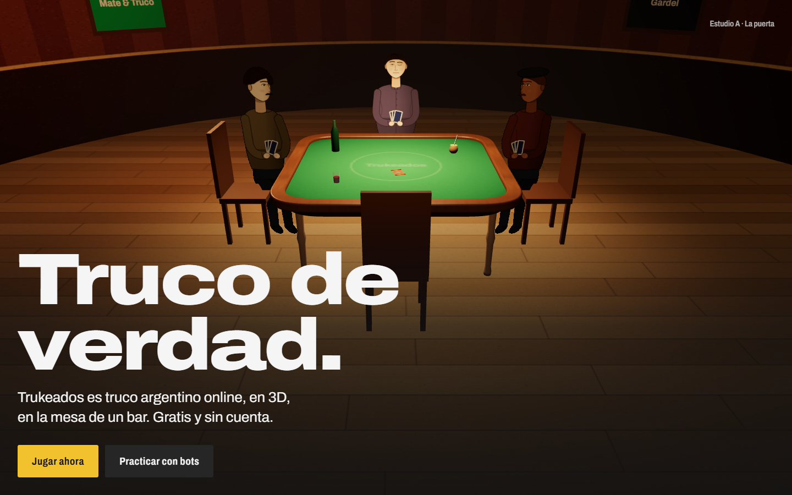
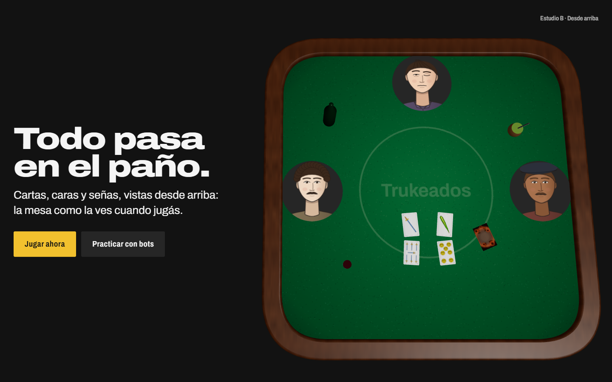
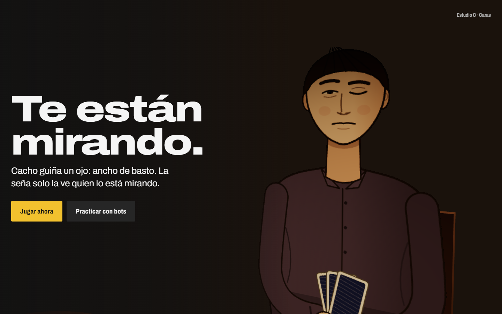

# Landing de Trukeados: contrato

Fase 2 de la skill `web-inmersiva`: brief, nivel, mapa de secciones, biblia de estilo y tres estudios de
dirección.

**Aprobado el 2026-11-06.** Dirección elegida: **A como mundo, con momentos de C y de B** (sección 5).
El juego está en `https://game.trukeados.com` y la landing en `https://trukeados.com` (2026-11-07).

Marca: [brand/BRAND.md](brand/BRAND.md) y [brand/PAGINAS.md](brand/PAGINAS.md) (copias del juego).
Contenido del juego: `docs/JUEGO.md` y `docs/REGLAS.md` en el repositorio `truco3D`.

## 1. Brief

| Tema | Respuesta |
|---|---|
| Qué es | Trukeados: truco argentino online, en 3D, gratis y sin cuenta. Te sentás a la mesa de un bar y las señas se hacen con la cara. |
| Quién llega | Gente que juega o jugó al truco (en familia, con amigos, en el club) y quiere jugar a distancia. Llega casi siempre por un link de WhatsApp, desde el celular. |
| Qué tiene que entender en una pasada | Que acá las señas son de verdad (si te miran, te las cazan), que estás en primera persona en un bar, que se puede hacer trampa, y que se juega gratis, ya. |
| Acción principal | **Jugar ahora** → `VITE_GAME_URL` (el menú del juego). Secundaria, más callada: **Practicar con bots**, que va al mismo menú hasta que el juego acepte parámetros (ver `brand/ALINEACION.md` §3 en el juego). |
| Fuente del contenido | El juego: reglas, señas, modos y tiempos reales. Sin métricas, testimonios, logos ni citas inventadas. |
| Dónde se ve | Celular primero, escritorio después. Importa el SEO y cómo se ve el link en WhatsApp (título, descripción, imagen). |
| Proyecto | Nuevo: `repository/truco3D-landing`, React 19 + Vite + TypeScript, R3F + GSAP + Lenis. |
| URLs | Juego: `https://game.trukeados.com`. Landing: `https://trukeados.com`. Las dos en Cloudflare Workers. |

## 2. Nivel: 3, mundo de scroll

La metáfora es un lugar (el bar) y la landing es un recorrido: entrás, mirás las caras y te sentás. Por eso
hay un canvas fijo detrás de todo el sitio, y el scroll mueve la cámara y los estados (arquitectura de la
skill, sección 7: director de scroll, `rig`, Lenis movido por el ticker de GSAP, 3D en `lazy()`).

Lo que no se negocia:
- El título y la CTA de la primera pantalla son HTML y se ven sin esperar a three.js.
- Existe la versión sin 3D (`?sin3d`, o sin WebGL), con pósters y textos alternativos.
- Con movimiento reducido, la cámara salta de sección en sección, sin recorrido.

## 3. Mapa de secciones

Una sección es una idea y un encuadre de cámara.

| # | `id` | Momento | Escena | Título | Cuerpo | Evidencia | Movimiento | `weight` |
|---|---|---|---|---|---|---|---|---|
| 1 | `inicio` | Gancho | El bar desde la puerta: la mesa con tres jugadores, tu silla vacía y la lámpara encima. | Truco de verdad. | Trukeados es truco argentino online, en 3D, en la mesa de un bar. Gratis y sin cuenta. | `JUEGO.md` §1-2 | La cámara entra | 1.2 |
| 2 | `a-ciegas` | Problema | La cámara se acerca y las caras quedan en sombra. | Online, nadie te mira a la cara. | Jugar a distancia es jugar a ciegas: no sabés si el otro se achica ni qué le pasó su compañero. | Planteo, no dato | Avanza hacia la mesa | 1.0 |
| 3 | `senas` | Idea | Primer plano de una cara que hace las señas una por una. | Las señas se hacen con la cara. | Once señas: cejas arriba, el ancho de espada; un guiño, el de basto; la boca torcida, un siete. | `config.js` `SENAS` (11) | Se acerca a la cara; cambian las señas | 2.0 |
| 4 | `mirada` | Mecanismo | Vista diagonal de la mesa: quién mira a quién. | Solo la ve quien te está mirando. | El servidor le manda tu seña únicamente a quien te mira en ese momento. Si te cazan, te cazaron. | `truco-room.js` (`deliverSena`), `REGLAS.md` | Orbita la mesa; giran las cabezas | 1.5 |
| 5 | `trampa` | Prueba | La carta quemada sobre el paño. | Acá también se puede hacer trampa. | Tirás dos encimadas: la de abajo juega y la de arriba queda quemada. Te pueden pedir que muestres las dos. | `REGLAS.md` (carta quemada) | Baja al paño; la carta se levanta | 1.5 |
| 6 | `mesas` | Resultado | La mesa cambia: dos, cuatro o seis lugares, y el anotador. | De a dos, de a cuatro o de a seis. | 1 vs 1, 2 vs 2 y 3 vs 3. A 15 o a 30 puntos, con flor o sin flor. Si se te corta, un bot juega por vos. | `config.js` `MODES`, `TARGETS`, `ROOM_OPTIONS`, `TIMING.afk` | La mesa se arma (cuadrada → hexagonal) | 1.5 |
| 7 | `sentate` | Acción | La vista desde tu silla, la misma del juego: los tres jugadores te miran. | La mesa está servida. | Poné tu nombre y mirá cómo te ven. Después, a jugar. | `characters.js` (`lookFor`) | La cámara se sienta | 1.4 |

CTA: **Jugar ahora** en la primera pantalla y en la sección 7, con la misma etiqueta en todo el recorrido.
Después de la sección 7 va el pie, con los créditos (cartas CC BY-SA 3.0, Archivo OFL).

**Coreografía** (fase 5). Cada sección dura `weight` pantallas: la primera es la llegada (viaja la cámara) y el
resto, la estadía (el texto queda fijo). Lo que cambia en la escena se reparte así:

| Sección | Mientras llega la cámara (`fxIn`) | Con el texto fijo (`fx`) |
|---|---|---|
| `inicio` | Nada: es el punto de partida | Nada |
| `a-ciegas` | Las caras quedan en sombra | Nada (dura una pantalla) |
| `senas` | Se ilumina la cara de Cacho; el resto sigue a oscuras | Cacho pasa por las 11 señas |
| `mirada` | Vuelve la luz | Coca y Tito se miran |
| `trampa` | Las cabezas vuelven a la mesa | La carta de arriba se levanta, quemada, y deja ver la de abajo |
| `mesas` | La carta vuelve a su lugar | La mesa pasa de cuatro a seis lugares |
| `sentate` | La mesa vuelve a cuatro, antes de que la cámara llegue a tu silla | Los tres te miran: es el instante del dorado |

**Composición en pantalla.** El inicio y el final llevan la escena arriba y el texto abajo en todos los tamaños:
el recorrido termina como empezó, con la vista del juego entera. Las demás secciones llevan el texto a la
izquierda en horizontal y abajo en vertical. Cada cámara mira a su tema y lo corre fuera del texto con un
encuadre (`frame` en `content/site.ts`), sin girar.

**Títulos en celular.** Con 31 a 34 caracteres, cuatro títulos ocupan tres líneas en 390 px. La marca pide dos
como máximo (`brand/PAGINAS.md`), pero se acepta la excepción solo en celular y los textos quedan como están
(2026-11-06).

**Lo interactivo** (sección 7): un campo "¿Cómo te llaman en la mesa?". Mientras escribís, tu cara aparece en
la silla vacía, dibujada con el mismo código del juego: el mismo nombre en el mismo lugar da siempre la misma
cara. El nombre todavía no viaja al juego; para eso hace falta el cambio `?nombre=` (`ALINEACION.md` §3).

## 4. Biblia de estilo

- **Clima**: nocturno, de barrio, en voz baja (como cuando se pasa una seña).
- **Metáfora**: el bar. El scroll es entrar y sentarte a la mesa.
- **Paleta** (toda de `tokens.css`, sin colores nuevos):
  - Campo: el bar en penumbra, `--bar` `#1a120c` en la escena y `--bg` `#121212` en la interfaz.
  - Tinta: `--text` `#f5f5f5`.
  - Luz: `--lampara` `#ffd9a0`, la única fuente cálida.
  - Paño: `--pano` `#2e7344` y `--pano-3` `#1a4529`.
  - Acento con significado: `--oro` `#f2c12e`, solo en "Jugar ahora" y en el instante en que alguien te mira.
  - Trampa: `--copa` `#d93b30`, solo en la carta quemada y en "¡Mostrá las dos!".
- **Tipografía**: Archivo, una sola familia. Display en 125 % y peso 850; lectura en 100 % y 400; rótulos en 78 %.
- **Materiales**: paño mate, madera barnizada, vidrio, cartón de naipe, pared pintada. Los personajes son
  dibujos 2D sobre planos, como en el juego. Solo brilla la lámpara.
- **Movimiento dominante**: travelling hacia la mesa, cabezas que giran para mirar, cartas que se asientan.
  Una sola cámara continua.
- **Ritmo**: lento al entrar, rápido en las señas, pausa en la trampa, quieto al sentarse.
- **Excepción: reflejo de moneda** (decisión del usuario, 2026-11-07; ver «Después del cierre»). Solo en los botones
  dorados (`.btn--primary`): un reflejo cruza el oro una vez al pasar el mouse o llegar con el teclado. Sin resplandor,
  sin degradé en el texto, sin loop, y apagado con movimiento reducido. Es la única excepción al cliché 2.
- **Tres clichés que se evitan**:
  1. Partículas o humo flotando "de ambiente".
  2. Brillo en todo: bloom, neón, dorado de casino.
  3. Texto sobre vidrio esmerilado o tarjetas con sombra encima de la escena.
- **Texto sobre la escena**: sobre una sombra neutra (degradé de `--bg`, la única excepción que permite la
  marca), con contraste de 4,5:1 o más. En celular, el texto va abajo y la escena arriba.

## 5. Estudios de dirección

Los tres usan el mismo bar, armado con las medidas del juego. Cambian la cámara, la luz, la composición y la
relación entre texto y escena. Se ven en `npm run dev`, en `/?estudio=a`, `/?estudio=b` y `/?estudio=c`.

### A · La puerta

- **Cámara**: de pie, de frente y alta. La mesa al centro, con tu silla vacía adelante.
- **Luz**: la lámpara como única luz cálida; las paredes en penumbra.
- **Composición**: la sala arriba y el título abajo, sobre sombra.
- **Recorrido**: entra desde la puerta, rodea la mesa en las señas y termina sentado en tu silla, que es la
  vista del juego.
- **A favor**: es el lugar, y termina justo donde empieza el juego.
- **En contra**: al principio las caras se ven chicas, y carga más 3D (la sala entera).

### B · Desde arriba

- **Cámara**: cenital, sin sala.
- **Luz**: pareja y gráfica.
- **Composición**: el paño como tablero a la derecha, el texto a la izquierda sobre el fondo de la marca.
- **Recorrido**: la cámara baja y gira sobre la mesa; las cartas se reparten y se juegan; las caras son fichas
  que cambian de seña.
- **A favor**: es el más legible y el más liviano, y explica reglas (la trampa, la jerarquía) con claridad.
- **En contra**: se pierden el bar y la primera persona. Es el menos inmersivo.

### C · Caras

- **Cámara**: a la altura de la cara de un jugador, con el resto a oscuras.
- **Luz**: de contorno, cálida y desde atrás.
- **Composición**: la cara a la derecha, el texto a la izquierda.
- **Recorrido**: cortes de cara en cara, una seña por scroll. Al final la cámara se aleja y aparece la mesa.
- **A favor**: la mecánica de las señas es la protagonista, y es muy humano.
- **En contra**: depende de un dibujo 2D muy grande (se nota que es plano) y da menos sensación de lugar.

### Recomendación

**A como mundo, con momentos de C y de B.** Es un solo bar y una sola cámara continua, como pide el nivel 3.
La sección de señas usa el primer plano de C, la de la trampa baja a la vista cenital de B, y el final se sienta
en tu silla. No mezcla modos: son encuadres distintos dentro del mismo mundo.

## 6. Estado técnico

- Las piezas del bar (sala, techo, lámpara, mesa, sillas, personajes, fichas, cartas) están en
  `src/three/bar/` con las medidas de `scene.js`, y la escena final las reutiliza. Los estudios están en
  `src/studies/` y cargan aparte (`?estudio=a|b|c`).
- El director de scroll (`src/scroll/useStoryTimeline.ts`) es lo único que escribe en `rig`: la cámara viaja
  en la llegada de cada sección y los efectos cambian según la coreografía (sección 3).
- `src/three/Experience.tsx` es el canvas fijo, en `lazy()`: la capa DOM no importa three. Dibuja el bar
  (`src/three/world/World.tsx`), con la exposición de luz del juego.
- Los personajes (`src/three/world/cast.ts`) son los recortes del juego: miran siempre a la cámara, el cuerpo
  apunta al centro de la mesa y la cabeza a quien miran, con los mismos ángulos que `scene.js`. Se redibujan
  solo cuando cambia la pose o la cara, como mucho dos por cuadro. Cacho se dibuja al doble de resolución
  para el primer plano.
- Mientras Cacho hace las señas, la leyenda marca la que está haciendo (`ui/SenasList.tsx` lee `rig`).
- La carta quemada en primer plano usa bordes carbonizados sin brasas (`charredTexture`), como la versión
  sin 3D: las brasas del juego, a ese tamaño y bajo la lámpara, se veían como manchas naranjas.
- `?gris` muestra la escena gris de la fase 5 (`src/three/gray/`), para ajustar tiempos sin el arte.
- El instante dorado (fase 7): al sentarte aparecen las placas de nombre del juego arriba de cada jugador
  (`brand/COMPONENTES.md` §6), con "te mira" en oro. Son HTML sobre el canvas, se ubican en cada cuadro y
  nunca salen de la pantalla: desde tu silla, Coca y Tito quedan en los bordes.
- Entrada: la escena aparece con un fundido cuando dibujó el primer cuadro, y la cámara llega desde un poco más
  atrás. Con movimiento reducido, sin recorrido.
- Niveles de calidad: `PerformanceMonitor` baja al nivel bajo si caen los cuadros por segundo (resolución 1 y
  un redibujo de personaje por cuadro) y sube si se recuperan.
- Sin postprocesado: la biblia de estilo evita el bloom, y la lámpara y la niebla ya cierran los bordes.
- Pósters de la versión sin 3D: `npm run capture -- posters` saca la escena de cada sección, centrada y sin
  el texto, en WebP (`public/posters/`, 240 KB los siete). Se vuelven a sacar si cambia una escena o una cámara.
- Celular acostado: todo al tamaño mínimo de la marca y la columna de texto más angosta.
- Costo de los personajes, medido con la CPU 4 veces más lenta (celular medio): unos 180 redibujos al recorrer
  toda la página, de 6 ms en promedio.
- Pesos: la landing, 132 KB gzip (límite 150); el paquete 3D, 256 KB gzip (límite 350). Como mucho 64 draw
  calls y 10 mil triángulos por cuadro (límites 150 y 500 mil).
- `npm run encuadres` calcula, sin renderizar, dónde cae cada cara, la mesa y las cartas en 1440, 768 y 390, y
  avisa si algo queda debajo del texto o fuera del cuadro.
- Capturas: `npm run build && npm run preview`, y en otra terminal `npm run capture -- director` (o `estudios`,
  `landing`). El set `director` captura cada sección en los tres tamaños, arma una hoja de contacto por tamaño
  y prueba que la escena vuelva a su estado al ir, volver y saltar, con movimiento reducido y sin 3D.
- `?debug` muestra el estado del director (sección, tramo, cámara y efectos).
- Carga (fase 8): la prueba de WebGL solo mira que exista la API (abrir un contexto de prueba costaba 1 s en un
  celular medio); si el contexto real falla, un ErrorBoundary pasa a la versión estática. Los shaders se
  compilan con `compileAsync` antes del primer cuadro (con la extensión de compilación en paralelo no traban la
  página). Archivo se precarga desde el HTML: sin eso, el cambio de fuente corría el panel del inicio.
- Compartir: `public/og.jpg` (la primera pantalla, 1200 x 630) y `public/apple-touch-icon.png`, con
  `npm run capture -- og`. Las etiquetas de Open Graph están en `index.html`; la URL absoluta sale de
  `VITE_SITE_URL` (plugin en `vite.config.ts`, que también agrega la canónica).

## 7. Fases

| Fase | Estado |
|---|---|
| 3. Base | Hecha |
| 4. Esqueleto HTML | Hecha |
| 5. Director de scroll y escena gris | Hecha |
| 6. Escenas definitivas: el bar, las señas, la mirada, la trampa, las mesas y la silla | Hecha |
| 7. Efectos, niveles de calidad y respaldos: el instante dorado de "te mira", niveles de calidad, pósters de la versión sin 3D, entrada de la escena, celular acostado | Hecha |
| 8. Verificación y entrega: build, recorrido en 390, 768 y 1440, Lighthouse móvil, `impeccable` y `vercel-react-best-practices` | Hecha |

### Verificación (fase 8)

Lighthouse móvil (CPU 4x y 4G lenta, Chrome sin GPU). Antes: la primera medición, con la fase 7. Después: cuatro
corridas del build final, con la mediana y el rango.

| | Antes | Después | Meta |
|---|---|---|---|
| LCP | 2.3 s | 2.2–2.3 s | < 2.5 s |
| CLS | 0.086 | 0 | < 0.1 |
| TBT | 1.87 s | 1.08 s (0.99–1.17) | lo más bajo posible (anticipa el INP) |
| Rendimiento / Accesibilidad / Buenas prácticas / SEO | 67 / 100 / 100 / 92 | 75 / 100 / 100 / 100 | |

- Dos corridas intermedias, antes del último ajuste de CSS, dieron TBT de 0,7 s y rendimiento de 80. Esa vez el
  equipo estaba menos cargado: el índice de benchmark de Lighthouse fue 4322 contra 3686–3978 en las corridas
  finales, con procesos de Chrome de pruebas anteriores todavía abiertos. En esta máquina el TBT varía unos
  0,3 s entre corridas, así que el número de un celular real es el que vale.

- Lo que queda del TBT es sobre todo crear el renderer de WebGL (pedir sus extensiones), que en un Chrome sin
  GPU (SwiftShader) es lento. Con GPU probablemente cueste menos, pero hay que medirlo en un celular real: el INP
  no se puede medir en laboratorio sin tocar la página.
- Teclado: el orden es el de lectura (saltar al contenido, barra, botones de cada sección, el campo del nombre,
  pie) y todo tiene el contorno oro de 2 px.
- Celular: sin scroll horizontal, áreas de toque de 44 px (salvo el enlace de la licencia, dentro de una
  oración) y con el texto al 200 % los títulos no se salen de la columna.
- `impeccable` (audit): el detector marca el borde de color de la placa de nombre; es el componente que define
  la marca del juego (`brand/COMPONENTES.md` §6), así que se deja. `vercel-react-best-practices`: sin cambios
  (React no re-renderiza con el scroll; el 3D va en su propio paquete y se pide apenas arranca la página).
- El director vuelve a pasar completo en 1440, 768 y 390.

Pendiente en un celular real: el INP y los picos de redibujo (con la CPU 4 veces más lenta hubo picos
aislados de unos 100 ms, que pueden notarse como un salto).

### Revisión final y cierre (2026-11-07)

- Última pasada con `impeccable`: el detector sobre `src/` e `index.html`, y las capturas del director en
  escritorio, tablet y celular. Se corrigió:
  - Las placas de Tito y de Coca quedaban bajo la barra de navegación en escritorio (el borde superior estaba en
    y = 61 y la barra llega a 64). Como la placa se ubica por su centro, el margen superior pasó de 76 a 88 px.
    Medido en 1440, 390 y 844 x 390: ninguna placa tapada.
  - La selección de texto es oro con tinta oscura, como los botones.
- Excepción registrada en `.impeccable/config.json`: `side-tab` solo en `src/styles/landing.css`. Es el borde de
  equipo de la placa de nombre, que define `docs/brand/COMPONENTES.md` §6. El detector queda en cero hallazgos.
- Landing cerrada. Queda fuera de esta fase: probar en un celular real (INP y picos al redibujar personajes),
  definir `VITE_GAME_URL` y `VITE_SITE_URL` (dominio), y la decisión del juego (merge de `marca-y-landing` y
  `docs/landing/PLAN.md`).

### Después del cierre

- **Reflejo de moneda en los botones dorados** (2026-11-07, decisión del usuario). Está en `src/styles/base.css`,
  dentro de `(hover: hover) and (pointer: fine)`, con su versión de movimiento reducido aparte. Contradice
  `brand/PAGINAS.md` §4 y `brand/BRAND.md` (sin brillos ni degradés en botones) y el cliché 2 de esta biblia; por
  eso queda como excepción documentada.
- Pendiente en el juego, porque `docs/brand` se sincroniza y no se edita desde la landing: agregar la excepción en
  `brand/PAGINAS.md` §4 y `brand/BRAND.md`, y el token `--oro-hover` en `brand/tokens.css` (lo propone
  `brand/ALINEACION.md` §4). Hoy el hover usa `#f5cc4f` escrito a mano en `base.css`.
- Sin verificar en el navegador todavía: el botón grande (`btn--big`), el foco por teclado y el recorrido en 768 y
  390 con el efecto. Comparten la regla del hover, pero no se midieron.

### Publicación

- Es un sitio estático: `npm run build` deja todo en `dist/`. Se publica en Cloudflare Workers, solo con
  archivos estáticos (`wrangler.jsonc`), desde `main` (antes estaba en Vercel). No hace falta reescritura de
  rutas: es una sola página.
- Variables al construir: `VITE_GAME_URL` (la dirección del juego, la usan todos los botones "Jugar") y
  `VITE_SITE_URL` (la de la landing, con barra al final). Sin definir, el build usa `https://game.trukeados.com`
  y `https://trukeados.com/`.
- Caché: `assets/` lleva el hash en el nombre y se cachea un año, `immutable` (`public/_headers`); `index.html`,
  sin caché.

